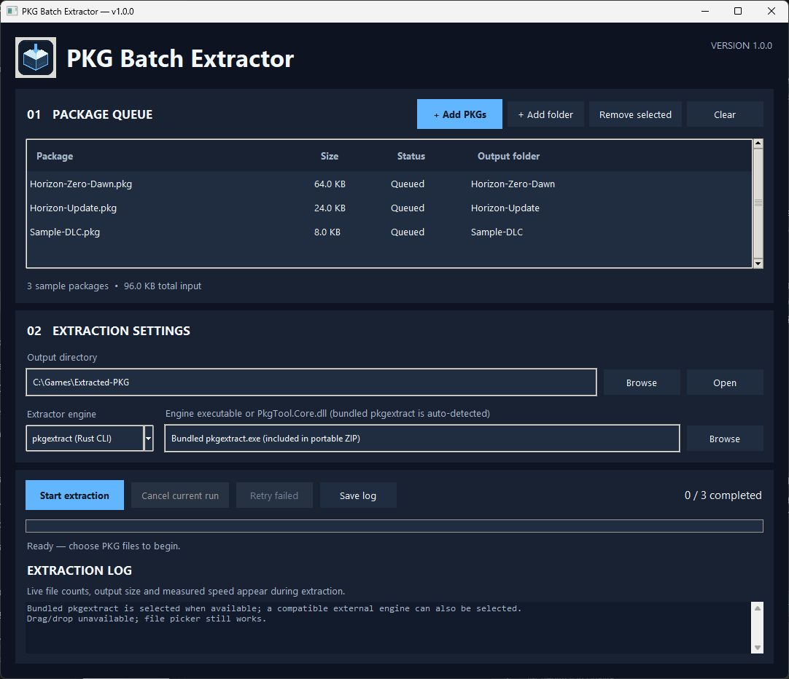

# PKG Batch Extractor

**PKG Batch Extractor 1.0.0** is a desktop batch-extraction tool for PlayStation 4 `.pkg` files. Select several packages, choose an output folder, and follow their extraction status in one window.



The screenshot shows the current interface with sample file names. It does not show a real PKG extraction.

## Platform support

| Platform | Status | Package | Clean-machine runtime requirements |
| --- | --- | --- | --- |
| Windows 10/11, x64 | **Official** | Portable ZIP containing the app `.exe` and `tools/pkgextract.exe` | No Python, Rust, pip, or separate engine installation |
| Linux, x86-64 | **Official** | AppImage containing the app and native `pkgextract` engine | No Python, Rust, pip, or separate engine installation; a compatible desktop/glibc environment is required |
| macOS, Intel and Apple Silicon | **Experimental** | Architecture-specific `.app` / `.dmg` builds when available | Not a supported 1.0.0 target; behavior and packaging may vary by macOS release |

Windows and Linux packages are intended to run offline. The build process bundles the Python/Tk runtime and the native Rust-based `pkgextract` engine. End users do not need development tools. Source-code runs and local builds have separate requirements below.

### Linux compatibility

The official Linux build target and the v1.0.0 AppImage are x86-64 builds made on Ubuntu 22.04.5 (glibc 2.35). The AppImage was opened and its bundled extractor and GUI startup were checked on that baseline. This is the compatibility baseline, not a guarantee for every distribution. AppImages are not guaranteed to run on Alpine or other musl-based systems, ARM Linux, or systems with glibc older than 2.35 or incompatible graphics libraries. Desktop Linux systems normally provide FUSE; if AppImage launch reports a FUSE error, try:

```sh
./PKG-Batch-Extractor-x86_64.AppImage --appimage-extract-and-run
```

The executable bit must be preserved. If needed, run `chmod +x PKG-Batch-Extractor-x86_64.AppImage` once.

## Features

- Add multiple PKG files or scan one folder; drag-and-drop is available when native TkDnD support loads.
- Extract packages sequentially into separate output folders. When available, the PS4 Title ID (for example `CUSA01022`) names the output folder; otherwise the package filename is used.
- Track exact **batch-level** progress by packages processed. The bundled engine does not provide a stable machine-readable total byte count or per-file progress protocol to this GUI, so the bar advances once each package finishes. It does not fabricate a within-package percentage or ETA.
- View live file and output-byte counts, elapsed time and a smoothed observed output speed in the activity status when enough measurements are available. The Extraction Log shows the engine's important messages, an elapsed-time-only progress line every five seconds during longer jobs, and the final result; it does not add file or byte summaries.
- Cancel the current extraction, retry failures, export the log, and receive a low-disk-space warning based on a labeled estimate.
- Avoid intentional output overwrites by extracting into a fresh staging directory; failed or cancelled partial files remain available for inspection.
- Works without a network connection after installation. No telemetry or account is used.

## Install and use

### Windows 10/11

1. Download and extract `PKG-Batch-Extractor-Windows-x64.zip` to a folder.
2. Keep `PKG-Batch-Extractor.exe` beside the included `tools` folder.
3. Double-click `PKG-Batch-Extractor.exe`.
4. Add `.pkg` files, choose an output directory, and select **Start extraction**.

The included `tools/pkgextract.exe` is required by the app and must stay in the ZIP's extracted folder. The app is unsigned; Windows SmartScreen may show a reputation warning. Verify the release source and signature/checksum where provided. Do not disable SmartScreen.

### Linux x86-64

1. Download `PKG-Batch-Extractor-x86_64.AppImage`.
2. Make it executable if necessary: `chmod +x PKG-Batch-Extractor-x86_64.AppImage`.
3. Launch it from the file manager or terminal.
4. Add `.pkg` files, choose an output directory, and select **Start extraction**.

The app and native extractor are inside the AppImage. No external Python, Rust, pip, or .NET runtime is needed for the default engine.

### macOS (experimental)

Architecture-specific `.app` and `.dmg` builds may be produced by CI. They are experimental and are not part of the official 1.0.0 support promise. Unless a release explicitly says otherwise, assume they are unsigned/not notarized; Gatekeeper may block them. Do not bypass Gatekeeper for an untrusted build.

## PKG engine and compatibility

Packaged builds include [`pkgextract`](https://github.com/paulomanrique/ps4-pkg-extractor/tree/f830abb76ef1cbb32c2f67c842a86187fa7f2d7c), built from the pinned upstream source revision. Its upstream CLI documents a terminal progress display, but the desktop process does not expose that output as a stable structured progress protocol, so this app reports reliable batch-level progress instead. Upstream license and lockfile notices are included with built packages.

The app does not include games, decryption keys or DRM-circumvention tools. Some protected or unsupported package types may fail. Use only PKGs you own or are authorized to handle.

## Build from source

These are developer instructions; users of the portable Windows ZIP and Linux AppImage do not need these tools.

- Python 3.11 or newer with Tcl/Tk
- Git, Rust/Cargo, and a native C/C++ toolchain
- Network access to retrieve the pinned extractor source
- Platform-specific packaging tools (including `appimagetool` for Linux)

```sh
python -m unittest discover -s tests -v
python -m compileall -q src tests tools run.py build.py
```

Build scripts are `build_windows.bat`, `build_linux.sh`, and `build_macos.sh`. Builds run on the native operating system; the GitHub Actions workflow builds Windows x64, Linux x86-64, and experimental macOS architecture packages on matching runners. Build artifacts are not committed to the source repository.

## Known limitations and verification

- A real, authorized PS4 PKG fixture was not available for this release validation. Automated extraction tests use a synthetic CLI and do not establish compatibility with every real package.
- Windows and Linux are the official targets. Linux AppImage compatibility is limited to tested glibc-based desktop environments; Alpine/musl and ARM are out of scope.
- Per-package byte percentage and ETA are not displayed because the GUI has no reliable total-output denominator from the bundled engine.
- Drag-and-drop depends on the platform's TkDnD library; file and folder pickers remain available without it.
- Cancellation preserves partial staging data. Review it before deleting it.
- macOS is experimental. Windows builds may trigger SmartScreen because they are not signed; any unsigned macOS package may trigger Gatekeeper.
- See [the validation report](docs/TEST_REPORT.md) for the platforms and package artifacts actually tested for this revision.

## License

The application is MIT-licensed. See [LICENSE](LICENSE). The bundled extractor and its dependencies have separate license terms; see [THIRD_PARTY.md](THIRD_PARTY.md) and the notices shipped with each package.

